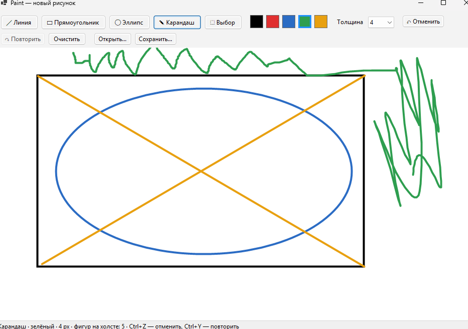

# Лабараторная работа номер 2. Графический редактор

Оконное приложение на C#: рисование линий, прямоугольников, эллипсов и карандашом.

# Как запустить

1. Установить .NET 8 SDK
2. В папке проекта:
   dotnet run
   Либо открыть `Lab2Paint.csproj` в Visual Studio и нажать F5.

# Скриншот

# Как пользоваться

- Выбрать инструмент, цвет и толщину на панели сверху.
- Зажать левую кнопку мыши на холсте и тянуть: фигура видна во время протягивания (в любую сторону).
- **Ctrl+Z** — отменить, **Ctrl+Y** — повторить, **Очистить** — убрать всё.
- **Сохранить… / Открыть…** — рисунок в JSON-файл и обратно.
- Инструмент **Выбор**: щелчок выделяет фигуру, мышью её можно перемещать, **Delete** удаляет.

## Чек-лист
- [x] 1. Окно: холст, выбор инструмента, цвета и толщины; выбранный инструмент подсвечен.
- [x] 2. Фигуры: линия, прямоугольник, эллипс с предпросмотром в любом направлении; карандаш рисует кривую.
- [x] 3. Иерархия: абстрактный `Shape`, у каждой фигуры свой `Draw`; рисунок рисуется одним циклом без проверки типа.
- [x] 4. Отмена и очистка: `Drawing.RemoveLast()` и `Drawing.Clear()` (Ctrl+Z / «Очистить»).
- [x] 5. Файл: сохранение/открытие JSON с цветами и толщинами; объекты создаёт `ShapeFactory`.
- [x] 6. README.
- [x] ★ Выделение щелчком, перемещение мышью, удаление клавишей Delete (`Shape.HitTest`, `Shape.Move`).
- [x] ★★ Паттерн Команда: `ICommand`, `AddShapeCommand`, `DeleteShapeCommand`, `ClearCommand`, `MoveShapeCommand`, `History` (два стека: undo и redo).
- [x] ★★ Паттерн Фабрика: `ShapeFactory`.

## Устройство проекта

| Класс | За что отвечает |
| `Shape` (абстрактный) | общее: точки, цвет, толщина, `Draw`, `HitTest`, `Move` |
| `LineShape`, `RectShape`, `EllipseShape` | свой `Draw` |
| `PencilShape` | хранит список точек, переопределяет `MoveEnd` |
| `ShapeFactory` | словарь «имя типа → как создать» |
| `Drawing` | список фигур: добавить, удалить, очистить, нарисовать, сохранить, загрузить |
| `ICommand`, `History` | отмена и повтор действий |
| `MainForm` | окно, инструменты, мышь |

Новая фигура = новый класс + одна строка в `ShapeFactory.Kinds`.
